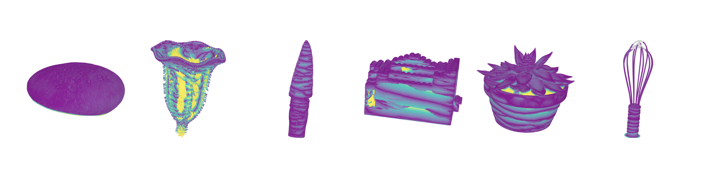

# eval-3d

[](LICENSE)
[](https://martine-benchmark.github.io/)
[](https://doi.org/10.7910/DVN/2BEPEH)
[](https://www.python.org/)
[](https://github.com/martine-benchmark/eval-3d/actions/workflows/tests.yml)

**eval-3d** scores reconstructed meshes against a ground-truth mesh: Chamfer distance and precision / recall /
F-score at fixed thresholds, over the whole object and per surface property. Built for the
[Martine](https://martine-benchmark.github.io/) benchmark, it runs on [other datasets](#other-datasets) too.

## Install

```bash
git clone https://github.com/martine-benchmark/eval-3d.git && cd eval-3d
uv sync                          # + `--extra visualization` for `visualize` (needs OpenGL or OSMesa)
```

Without uv: `pip install -e ".[visualization]"` in Python 3.10 or later.
**Requirements**: CPU only, no GPU. RAM grows with the point clouds: 0.3 GB for the example below, 7 GB for a
COLMAP mesh of the Martine rock, up to 256 GB for the largest objects.

## Getting started

### 1. Run the example

```bash
mkdir -p runs/lego/pgsr_d4/results_raw
cp tests/data/lego/pgsr_d4.ply runs/lego/pgsr_d4/results_raw/mesh.ply
uv run eval-pipeline -c config/example.yaml run
```

This scores a PGSR reconstruction of the Martine lego against a reduced copy of its ground truth
([tests/data](tests/data/README.md)), in about 10 s. The run ends with:

```text
  Chamfer: 0.5352
  F-score@1.0: 0.8639
Completed: 2/2 jobs succeeded
```

### 2. Add your mesh

One folder per object and method, the mesh in the dataset frame and in millimetres:

```text
runs/
└── rock/                    # Martine object name
    └── my_method/
        └── results_raw/mesh.ply   # or mesh.obj
```

### 3. Point a config to your data

Download the evaluation kit (`--groundtruth`) of your objects with
[martine-dataset](https://github.com/martine-benchmark/martine-dataset#download), then copy the Martine config and
set its two paths:

```bash
cp config/martine.yaml config/martine.local.yaml
```

```yaml
paths:
  dataset_root: "/data/martine"   # the download, one folder per object
  eval_root: "runs/{object}"      # the tree of step 2 (the default)
```

### 4. Run

```bash
uv run eval-pipeline -c config/martine.local.yaml run -o rock -m my_method
```

`run` carves the mesh to the silhouettes (`cleanup`), then scores it (`evaluate`).

### 5. Read the result

`runs/rock/my_method/eval_results/metrics.json` holds the Chamfer distance (mm) and the precision, recall and
F-score at 0.5, 1, 1.5, 2 and 5 mm ([docs/metrics.md](docs/metrics.md)). For the example of step 1:

```json
"chamfer": 0.535,
"fscore": [0.638, 0.864, 0.900, 0.925, 0.954],
```

## Main commands

| Command | Example |
| :-- | :-- |
| `run` | `run -o rock -m my_method`: `cleanup` then `evaluate`; without `-o`/`-m`, every cell of the config; `--slurm` on a cluster |
| `cleanup` | `cleanup -o rock -m my_method`: carve vertices that project outside every silhouette |
| `evaluate` | `evaluate -o rock -m my_method`: distances, Chamfer, F-score → `metrics.json` |
| `aggregate` | `aggregate`: collect the metrics of every object and method into tables (per property after `apply-masks`) |
| `visualize` | `visualize -o rock -m my_method`: per-point error renders (`visualization` extra) |

Each takes `-c <config>` first. All commands: [docs/cli.md](docs/cli.md) or `uv run eval-pipeline --help`.

## Before you start

- **Frame and units**: the mesh must be in the frame of the ground truth, in millimetres. A mesh in camera units
  or another frame is not detected: it scores as a poor or empty reconstruction.
- **What counts**: geometry outside every silhouette (floor, background) is carved away before scoring, so it is
  neither rewarded nor penalised.
- **Not measured**: normal accuracy and appearance; the scores are geometric only.

## Other datasets

Configs for DiLiGenT-MV, LUCES-MV, Skoltech3D, DTU and EvalMVX ship in `config/`. Any dataset arranged as in
[docs/input-layout.md](docs/input-layout.md) works; [docs/datasets.md](docs/datasets.md) shows how to add one.

## Documentation

| Document | Covers |
| :-- | :-- |
| [docs/input-layout.md](docs/input-layout.md) | The on-disk layout the pipeline expects, GT discovery, camera formats |
| [docs/configuration.md](docs/configuration.md) | The config keys that change your numbers; units |
| [docs/pipeline.md](docs/pipeline.md) | The end-to-end command flow, stage by stage |
| [docs/cli.md](docs/cli.md) | Every command in one table |
| [docs/metrics.md](docs/metrics.md) | Every field of `metrics.json`; why `NaN` is a result |
| [docs/challenges.md](docs/challenges.md) | Per-region evaluation (surface properties, excluded zones), adding your own region |
| [docs/datasets.md](docs/datasets.md) | The bundled configs and how to add a dataset |
| [docs/cluster.md](docs/cluster.md) | Running on SLURM |
| [docs/figures.md](docs/figures.md) | Paper figures and tables; the Martine specification as an example |

## Tests

`uv run pytest` runs the suite on CPU. Tests that render with OpenGL are marked `gl` and skipped without a backend;
the paper regression tests run only when `EVAL_FIGURES_REF` points to the paper's evaluation outputs.

## License

MIT, see [LICENSE](LICENSE).

## Citation

If you use this code, please cite the Martine paper:

```bibtex
@inproceedings{martine2026,
  title={Martine: Benchmarking Multi-View 3D Surface Reconstruction Across Viewpoint Coverage, Resolution, and Lighting},
  author={Bruneau, Robin and Brument, Baptiste and Giraud, Frederic and Sigrist, Bastian and Jecklin, Sascha and Fürnstahl, Philipp and Menze, Bjoern and Calvet, Lilian},
  booktitle={NeurIPS Evaluations \& Datasets (E\&D) Track},
  year={2026}
}
```
